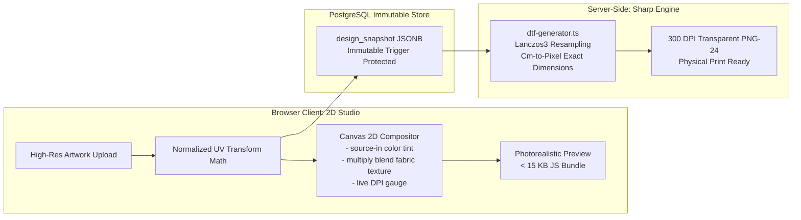

# Solen (سولين) — System Documentation & Architecture Hub

<div align="center">

[](https://solen-web.vercel.app/)
[](https://www.youtube.com/watch?v=YOUR_VIDEO_ID)
[](https://github.com/laithmh/solen-docs)

<br/>

-black?style=flat-square&logo=next.js)


-brightgreen?style=flat-square)
-blue?style=flat-square)


<p align="center">
  <strong>Iraq’s pioneering B2B2C Print-on-Demand (POD) and creator commerce platform</strong><br/>
  Empowering local content creators, artists, and streamers to design, launch, and monetize physical merchandise with zero inventory risk, tailored Cash on Delivery (COD) workflows, and industrial Direct-to-Film (DTF) print automation.
</p>

</div>

---

## 📌 Quick Access & Key Links

- 🌐 **Live Web Application**: [https://solen-web.vercel.app/](https://solen-web.vercel.app/)
- 📺 **Video Walkthrough & Platform Demo**: [Watch on YouTube](https://www.youtube.com/watch?v=YOUR_VIDEO_ID) *(Replace `YOUR_VIDEO_ID` with the published YouTube link)*
- 📚 **Documentation Repository**: [https://github.com/laithmh/solen-docs](https://github.com/laithmh/solen-docs)
- 🔒 **Core Application Repository**: Private (Proprietary / Solen Team)

---

## 📺 Video Walkthrough & Interactive Demo

Below is the demo preview for the Solen platform. Click the banner below to watch the complete walkthrough of the creator studio, storefront checkout, and production hub:

<div align="center">

[](https://www.youtube.com/watch?v=YOUR_VIDEO_ID)

> 💡 **YouTube Link Configuration**:
> When your video is live, replace `YOUR_VIDEO_ID` above (and in the badges) with your YouTube video ID (e.g. `https://www.youtube.com/watch?v=ABC123XYZ`).

</div>

---

## 📖 About Solen (سولين)

In emerging markets like Iraq, thousands of content creators, digital artists, calligraphers, gaming streamers, and boutique brands sell merchandise primarily through Instagram and TikTok DMs. This manual model suffers from severe operational bottlenecks:
- Creators must front capital to buy bulk inventory upfront in uncertain sizes and colors.
- Order management is handled manually via WhatsApp/Instagram chats.
- Order fulfillment relies on informal, uncalibrated local print shops with high defect rates.
- Cash on Delivery (COD) return rates are rampant due to nonexistent order verification and customer friction.
- Payment rails are fragmented between cash and emerging mobile wallets (ZainCash, FIB, Qi Card).

**Solen eliminates all friction by introducing a turnkey Print-on-Demand platform built specifically for Iraq's market realities:**
1. **For Creators (B2B)**: Zero upfront capital, zero minimum order quantities (MOQ), and zero inventory risk. A creator uploads high-resolution artwork, designs apparel in an in-browser 2D studio with realistic garment compositing, sets their own profit margin in Iraqi Dinars (`IQD`), and instantly launches a trilingual branded storefront with a shareable URL and QR code.
2. **For Shoppers (B2C)**: A frictionless localized shopping experience supporting all 18 Iraqi governorates, real-time shipping calculation, automated phone normalization (+964), Cash on Delivery (COD), order tracking via order number and phone verification, and trilingual localization (Arabic, Kurdish Sorani, and English).
3. **For Print Hubs & Operations**: Automated server-side generation of 300 DPI transparent DTF (Direct-to-Film) print-ready files, automated piece-code generation for garment routing, an industrial Production Hub for print stations, and a T+3 post-delivery automated earnings clearance system.

---

## 🧭 Documentation Index

This repository contains the full technical specifications, architecture blueprints, database schemas, security models, and portfolio case studies for the private core application.

### 📐 Core Engineering Documentation

| Document | Description | Direct Link |
|---|---|---|
| **System Architecture** | Decoupled render pipelines, normalized UV coordinate standards, Next.js 16 app layout, and server actions. | [`docs/architecture.md`](./docs/architecture.md) |
| **Database Architecture** | 14+ PostgreSQL tables, Row-Level Security (RLS), custom RPC functions, and transaction models. | [`docs/database.md`](./docs/database.md) |
| **Security Architecture** | Threat modeling, RLS enforcement, anti-fraud rate limiters, COD abuse mitigation, and input sanitization. | [`docs/security.md`](./docs/security.md) |
| **Design System & i18n** | Trilingual token system (Arabic, Kurdish Sorani, English), RTL/LTR layout flipping, and typography. | [`docs/design-system.md`](./docs/design-system.md) |
| **CI/CD Pipeline** | 4-stage GitHub Actions workflow, preview environments, automated linters, and Vercel production gates. | [`docs/ci-cd.md`](./docs/ci-cd.md) |
| **Testing Strategy** | 445 automated unit and integration tests across 56 test suites, and Playwright E2E coverage. | [`docs/testing.md`](./docs/testing.md) |
| **Observability & Health** | Error boundary hierarchies, custom structured logging, database health checks, and metrics. | [`docs/observability.md`](./docs/observability.md) |
| **Local Environment Setup** | Developer onboarding, environment variables, local Supabase CLI, and seed scripts. | [`docs/setup.md`](./docs/setup.md) |
| **Code Standards** | Engineering principles, TypeScript conventions, component composition, and git hygiene. | [`docs/code-standards.md`](./docs/code-standards.md) |

### 💼 Portfolio & Deep-Dive Specifications

| Deep Dive | Summary | Direct Link |
|---|---|---|
| **00. Project Overview** | Executive summary, market problem analysis, creator/shopper/print operator personas, and economics. | [`docs/portfolio/00-project-overview.md`](./docs/portfolio/00-project-overview.md) |
| **01. Feature Inventory** | Comprehensive 100+ feature inventory across auth, studio, storefront, production, and admin. | [`docs/portfolio/01-feature-inventory.md`](./docs/portfolio/01-feature-inventory.md) |
| **02. User Flows** | Detailed end-to-end journey maps for Creators, Shoppers, Print Operators, and Platform Admins. | [`docs/portfolio/02-user-flows.md`](./docs/portfolio/02-user-flows.md) |
| **03. Deep Architecture** | In-depth technical architecture, client/server rendering math, coordinate mapping, and security. | [`docs/portfolio/03-architecture.md`](./docs/portfolio/03-architecture.md) |
| **04. Database Deep Dive** | Complete database catalog, entity relationship diagrams, stored procedures, and triggers. | [`docs/portfolio/04-database.md`](./docs/portfolio/04-database.md) |
| **05. Portfolio Case Study** | Full-stack engineering narrative, architecture decisions, trade-offs, and measurable outcomes. | [`docs/portfolio/05-portfolio-case-study.md`](./docs/portfolio/05-portfolio-case-study.md) |
| **06. Resume & Metrics** | High-impact technical accomplishment bullets with concrete metrics for portfolio presentations. | [`docs/portfolio/06-resume-bullets.md`](./docs/portfolio/06-resume-bullets.md) |

---

## 🏗️ System Architecture & Core Innovations

### 1. Dual-Pipeline Rendering Engine

To avoid sluggish mobile 3D WebGL runtimes while ensuring industrial physical print fidelity, Solen implements a decoupled dual-pipeline rendering engine governed by a single normalized UV coordinate standard:



- **Client Preview (`renderPlacement.ts`)**: Fast, lightweight HTML5 2D canvas compositing with garment wrinkle overlays, dynamic garment tinting, and real-time DPI advisory feedback.
- **Server DTF Engine (`dtf-generator.ts`)**: Server-side Sharp-powered image generator that reads exact physical dimensions (`print_width_cm` × `print_height_cm`), scales original artwork at 300 DPI, and produces pristine transparent PNG-24 print files without background artifacts.

---

### 2. Anti-Fraud Cash on Delivery (COD) State Machine

Because Cash on Delivery accounts for >85% of Iraqi transactions, Solen treats order lifecycle states with strict database-level trigger invariants:

```mermaid
stateDiagram-v2
    [*] --> Pending: Guest Checkout (COD)
    Pending --> Processing: Merchant / Admin Verification
    Processing --> Printing: Sent to Print Hub
    Printing --> Packaging: DTF Pressed & Quality Verified
    Packaging --> Shipped: Handed to Iraqi Courier
    Shipped --> Delivered: Doorstep Cash Collected
    Delivered --> Settled: T+3 Safe Buffer Clearance
    
    Pending --> Cancelled: Customer / Admin Cancel
    Processing --> Cancelled: Out of Blanks
    Shipped --> Returned: Delivery Refused
```



- **Immutable Snapshots**: Order placements freeze a `design_snapshot` JSONB. Database triggers strictly prevent modifications to design coordinates post-order.
- **T+3 Delivery Clearance**: Creator earnings remain in a `pending` state until the order is physically marked `delivered` and cash is collected, unlocking for withdrawal after a 72-hour fraud buffer.
- **Zero-Float Accounting**: All monetary values are calculated in integer Iraqi Dinars (`IQD`) to prevent floating-point calculation drift.

---

## 🛠️ Technology Stack Summary

| Layer | Technologies & Tools |
|---|---|
| **Framework & Runtime** | [Next.js 16](https://nextjs.org/) (App Router, Server Actions, React 19) |
| **Language** | [TypeScript 5.x](https://www.typescriptlang.org/) (Strict Mode) |
| **Styling & Components** | [Tailwind CSS](https://tailwindcss.com/), Radix UI Primitives, Lucide Icons |
| **Database & Auth** | [Supabase](https://supabase.com/) (PostgreSQL 15, Row-Level Security, Auth, Edge Storage) |
| **Image Processing** | [Sharp](https://sharp.pixelplumbing.com/) (High-performance 300 DPI DTF export) |
| **Testing** | [Vitest](https://vitest.dev/), [Playwright](https://playwright.dev/) (445 automated tests, 56 suites) |
| **Localization (i18n)** | Custom Trilingual Engine (Arabic, Kurdish Sorani, English) with RTL support |
| **Deployment & Hosting** | [Vercel](https://vercel.com/) (Edge routing, serverless API functions) |

---

## 🔄 Connecting & Synchronizing This Repository

This repository is linked to the GitHub remote at `https://github.com/laithmh/solen-docs`.

To stage, commit, and push changes to GitHub:

```bash
# 1. Check current status
git status

# 2. Stage all documentation files and configuration
git add .

# 3. Create commit
git commit -m "docs: import comprehensive Solen architecture specifications and portfolio docs"

# 4. Push to main branch on GitHub
git push -u origin main
```

---

<div align="center">
  <sub>Solen Platform &copy; 2026. All documentation is confidential and intellectual property of Solen.</sub>
</div>
