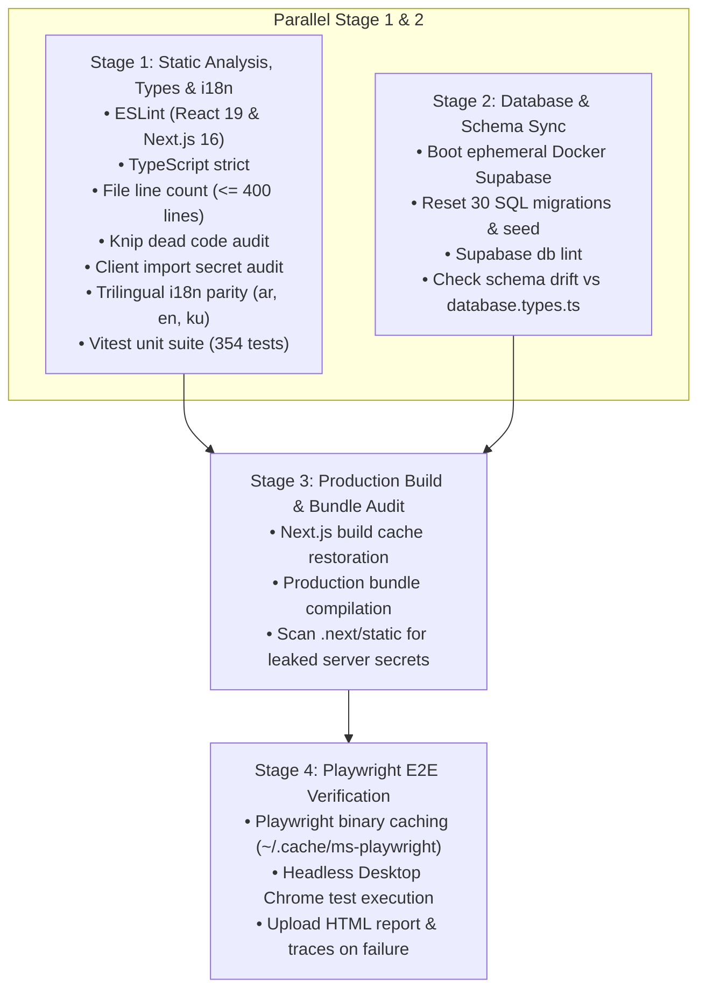

# CI/CD Pipeline & Deployment Specifications

Solen Atelier leverages **GitHub Actions**, **Vercel CLI**, and **Supabase CLI** to implement automated continuous integration, schema drift verification, client secret bundle auditing, and zero-downtime production deployments.

> [!NOTE]
> Master guidelines: [`AGENTS.md`](file:///d:/flutter_projects/solen_web/AGENTS.md) and [`.agents/rules/`](file:///d:/flutter_projects/solen_web/.agents/rules/).

---

## 1. Continuous Integration (CI) Pipeline

Automated through [`.github/workflows/ci.yml`](file:///d:/flutter_projects/solen_web/.github/workflows/ci.yml). Triggers on `push`, `pull_request` (targeting `master` or `main`), and manual `workflow_dispatch`.

### Path-Based Runner Optimization
Documentation (`**.md`, `docs/**`), IDE settings (`.vscode/**`), and agent specifications (`.agents/**`) are excluded via `paths-ignore` to conserve GitHub Actions runner minutes on private repositories.

### Four-Stage Architecture

### Artifact & Trace Retention
When end-to-end tests fail or require review, `actions/upload-artifact@v4` preserves Playwright HTML reports, screenshots, and trace archives with a **7-day retention period**.

---

## 2. Preview Deployments (Vercel)

Managed through [`.github/workflows/preview.yml`](file:///d:/flutter_projects/solen_web/.github/workflows/preview.yml).
- Automatically provisions isolated ephemeral preview environments on pull requests.
- Leverages pinned `vercel@^63` CLI.
- Automatically posts or updates an interactive status comment on the pull request with direct links to the generated preview URL and commit metadata.
- Excludes markdown and documentation updates via `paths-ignore`.

---

## 3. Production Deployments (Continuous Deployment)

Managed through [`.github/workflows/deploy.yml`](file:///d:/flutter_projects/solen_web/.github/workflows/deploy.yml).
- Triggers on successful completion of `Continuous Integration (CI)` on `master`/`main` or manual `workflow_dispatch`.
- **Migration-First, Code-Second Guarantee**:
  1. Compiles frontend production artifacts to verify zero build failures.
  2. Pushes cloud PostgreSQL migrations via `supabase db push` (pinned Supabase CLI `2.118.0`).
  3. Deploys the verified prebuilt artifacts to Vercel Production with automated 3-attempt transient retry logic.

---

## 4. Rollback & Disaster Recovery Strategy

- **Vercel Rollback**: Instant zero-downtime rollback to the previous successful production deployment directly via Vercel dashboard or CLI.
- **Backward-Compatible Schema Design**: All database migrations must follow additive design patterns (e.g. nullable new columns, non-breaking views) so that rollbacks in application code do not cause instant database query breakage.
