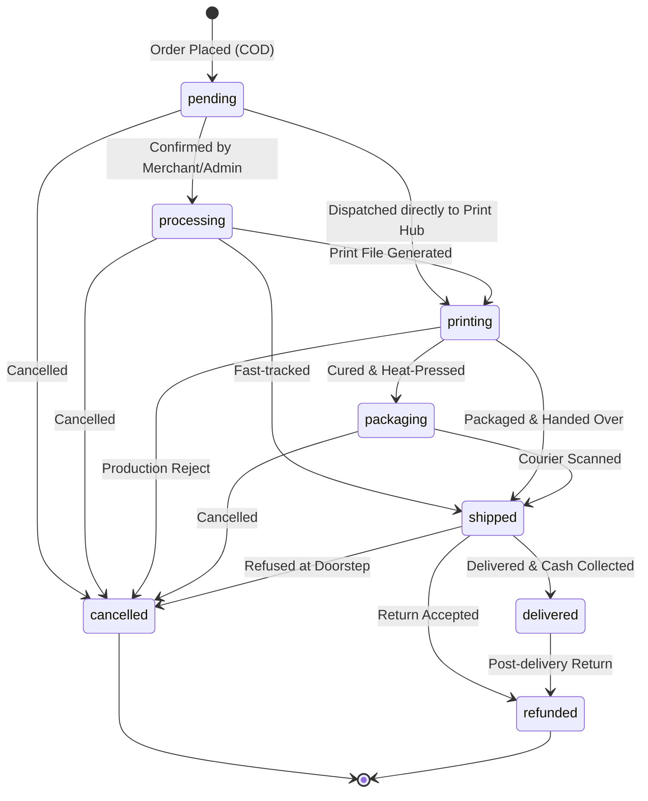

# Solen — Comprehensive Feature Inventory & Codebase Review

This document provides a feature-by-feature review of the Solen codebase, detailing user flows, code references, database entities, and engineering edge cases across all 17 platform domains.

---

## 1. Authentication & Role-Based Access Control (RBAC)

### User Flow
1. **Visitor Signup/Login**: Users register via email/password or Google OAuth. Verification email is dispatched.
2. **Profile Sync**: Supabase `on_auth_user_created` trigger automatically provisions a row in `profiles` with default role `customer`. Google metadata (avatar, name) is automatically synchronized.
3. **Role Elevation & Access Control**: Platform supports 5 distinct roles:
   - `customer`: Public storefront browsing, guest/authenticated checkout, order tracking.
   - `designer`: Access to `/studio/[mockupId]`, `/dashboard` (creator center), storefront branding.
   - `printer`: Access to `/dashboard/production` (print queue, DTF downloads, packing slips).
   - `production_manager`: Extended production controls (courier handover, job rescheduling).
   - `admin`: Global governance (`/dashboard/admin`), financials, user management, audit logs.
4. **Proxy & Routing Guards**: Executed in `proxy.ts` (Next.js middleware) before page render. Unauthenticated users attempting to access protected creator/admin routes are redirected to `/[locale]/login?returnUrl=...`. Authenticated users visiting auth routes are routed to their designated home.

### Key Code References
- **Middleware**: [`proxy.ts`](file:///d:/flutter_projects/solen_web/proxy.ts)
- **Actions & Validation**: [`lib/auth/actions.ts`](file:///d:/flutter_projects/solen_web/lib/auth/actions.ts), [`lib/auth/validation.ts`](file:///d:/flutter_projects/solen_web/lib/auth/validation.ts)
- **Role Routing**: [`lib/auth/role-routes.ts`](file:///d:/flutter_projects/solen_web/lib/auth/role-routes.ts), [`lib/auth/admin-guard.ts`](file:///d:/flutter_projects/solen_web/lib/auth/admin-guard.ts)
- **UI Components**: [`components/auth/login-form.tsx`](file:///d:/flutter_projects/solen_web/components/auth/login-form.tsx), [`components/auth/register-form.tsx`](file:///d:/flutter_projects/solen_web/components/auth/register-form.tsx), [`components/auth/google-auth-button.tsx`](file:///d:/flutter_projects/solen_web/components/auth/google-auth-button.tsx)

### Database & Security
- Table: `profiles` (references `auth.users(id)` ON DELETE CASCADE).
- Protection: `protect_profile_role` trigger prevents users from self-elevating their role via client-side Supabase updates.

---

## 2. Landing Page & Creator Growth Engine

### User Flow
1. **Hero & Value Proposition**: Engaging typography introducing Solen as Iraq's premier POD marketplace with clear CTAs ("Start Creating", "Explore Catalog").
2. **Garments Showcase**: Visual carousel of available blanks (280 GSM Oversized T-shirt, 360 GSM Heavyweight Hoodie, Premium Sweatshirt).
3. **Interactive Profit Simulator**: Dynamic slider allowing creators to simulate monthly earnings in IQD based on estimated sales volume and chosen markup.
4. **Iraq Shipping Calculator**: Interactive dropdown for 18 Iraqi governorates displaying exact shipping cost (IQD) and estimated delivery window (1–3 days).
5. **COD Trust Banner**: Explains COD safety, quality assurance, and doorstep delivery across Iraq.

### Key Code References
- Page: [`app/[locale]/page.tsx`](file:///d:/flutter_projects/solen_web/app/[locale]/page.tsx)
- Components: [`components/landing/creator-profit-simulator.tsx`](file:///d:/flutter_projects/solen_web/components/landing/creator-profit-simulator.tsx), [`components/landing/iraq-shipping-calculator.tsx`](file:///d:/flutter_projects/solen_web/components/landing/iraq-shipping-calculator.tsx), [`components/landing/garments-showcase.tsx`](file:///d:/flutter_projects/solen_web/components/landing/garments-showcase.tsx), [`components/landing/cod-trust-banner.tsx`](file:///d:/flutter_projects/solen_web/components/landing/cod-trust-banner.tsx)

---

## 3. Creator Studio & 2D Flat Editor

### User Flow
1. **Blank Selection**: Creator chooses garment type (e.g., Heavyweight Boxy Tee).
2. **Placement Navigation**: Dynamic placement tabs populated from `mockup_placements` (Front, Back, Left Sleeve, Right Sleeve).
3. **Artwork Upload & Drag-and-Drop**: Creator drags or uploads PNG/JPEG/WEBP graphic.
4. **Canvas Manipulation**:
   - Live interactive dragging with mouse or touch gestures (`use-canvas-drag.ts`).
   - Rotation slider (0° to 360°).
   - Scale slider (0.05× to 2.5× containment).
   - Alignment action buttons (Center Horizontally, Center Vertically, Reset).
5. **Colorway Selection**: Multi-select swatches for garment blank colors enabled for this design.
6. **Live DPI Advisory**: Real-time gauge calculating effective print resolution based on original image pixel dimensions, placement physical centimeters, and user scale factor.

### Key Code References
- Main Wizard: [`components/studio/studio-wizard.tsx`](file:///d:/flutter_projects/solen_web/components/studio/studio-wizard.tsx)
- 2D Canvas Surface: [`components/studio/studio-canvas-2d.tsx`](file:///d:/flutter_projects/solen_web/components/studio/studio-canvas-2d.tsx)
- Gesture Hook: [`components/studio/use-canvas-drag.ts`](file:///d:/flutter_projects/solen_web/components/studio/use-canvas-drag.ts)
- DPI Gauge: [`components/studio/dpi-gauge.tsx`](file:///d:/flutter_projects/solen_web/components/studio/dpi-gauge.tsx), [`components/studio/dpi-advisory-banner.tsx`](file:///d:/flutter_projects/solen_web/components/studio/dpi-advisory-banner.tsx)
- Coordinate Math: [`lib/render/math.ts`](file:///d:/flutter_projects/solen_web/lib/render/math.ts)

---

## 4. Render Engine & High-Res DTF Print Generator

### Technical Implementation
The platform employs two decoupled rendering pipelines:

1. **Client-Side Photorealistic Garment Preview (`mode: 'preview'`)**:
   - Implemented in [`lib/render/renderPlacement.ts`](file:///d:/flutter_projects/solen_web/lib/render/renderPlacement.ts).
   - Uses an offscreen HTML5 2D canvas (1024×1024 px).
   - Dynamically tints the garment base using `source-in` composite operations.
   - Calculates contain-fit aspect scaling and draws artwork centered at normalized UV coordinates `(u, v)`.
   - Composites garment wrinkle and shadow overlays using `multiply` blend mode.

2. **Server-Side Physical DTF Print Engine (`mode: 'print'`)**:
   - Implemented in [`lib/print/dtf-generator.ts`](file:///d:/flutter_projects/solen_web/lib/print/dtf-generator.ts) via `sharp`.
   - Calculates exact physical canvas dimensions: `(print_width_cm / 2.54) * 300 DPI`.
   - Renders 100% transparent background (zero garment color/texture).
   - Scales artwork with lanczos3 interpolation, rotates strictly about artwork center, clips to printable bounding box.
   - Exports 300 DPI uncompressed PNG-24 with physical density metadata.

### Invariants Enforced
- **Invariant #3**: Preview images are textured and shaded; print files are flat, unshaded, transparent PNG-24 at 300 DPI.
- **Invariant #5**: Default fit is always `contain`—artwork aspect ratios are never distorted.

---

## 5. Multi-Asset Publishing Pipeline & Rollback Resilience

### User Flow
1. **Metadata & Pricing**: Creator sets design title, description, category, and desired profit markup (e.g., 8,000 IQD).
2. **Lifestyle Mockup Upload**: Optional upload of front/back lifestyle model photos.
3. **Atomic Execution (`useStudioPublisher`)**:
   - Renders 1024px preview images for all configured placements.
   - Generates original artwork and preview blobs.
   - Creates a new record in `user_designs` with status `pending_review` or `draft`.
   - Uploads assets to Supabase Storage buckets (`user-design-originals`, `user-design-previews`).
   - Inserts rows into `user_design_placements` with normalized UV coordinates.
   - Executes database RPC `create_design_and_auto_variants` to generate product variants matrix across selected colors and in-stock sizes.
4. **Resilient Rollback**: If any network failure, validation error, or storage write fails halfway, the hook automatically purges uploaded storage files and deletes draft database rows to prevent orphan data corruption.

### Key Code References
- Hook: [`components/studio/use-studio-publisher.ts`](file:///d:/flutter_projects/solen_web/components/studio/use-studio-publisher.ts)
- RPC Migration: `supabase/migrations/20260101000004_storefront_and_publish_pipeline.sql`

---

## 6. Creator Merchant Dashboard

### User Flow
Located at `/[locale]/dashboard`, providing creators with operational autonomy:
1. **Overview Tab**: KPI cards showing Total Revenue (IQD), Pending Earnings (T+3 hold), Available Withdrawable Balance, and Active Designs count.
2. **Products Tab**:
   - Table and grid views of published designs with status badges (`approved`, `pending_review`, `rejected`).
   - Quick price markup editor and design archive/deletion with storage asset cascade.
3. **Orders Tab**:
   - Real-time list of customer orders containing the creator's merchandise.
   - Customer details, governorate, status badge, items list, and net creator earnings.
   - Single-click **WhatsApp Direct Link** (`lib/whatsapp/wa-link.ts`) pre-formatted with Iraqi phone and order message for customer communication.
   - Order confirmation and cancellation actions (`merchantConfirmAndDispatchAction`, `merchantCancelOrderAction`).
4. **Payouts Tab**:
   - Payout history with rail status (`zain_cash`, `fib`, `qi_card`).
   - Payout request dialog enforcing minimum withdrawal threshold (25,000 IQD) and daily limit (500,000 IQD).
5. **Promos Tab**: Creator-funded promo vouchers scoped exclusively to their own storefront.

### Key Code References
- Dashboard Container: [`components/merchant/merchant-dashboard-view.tsx`](file:///d:/flutter_projects/solen_web/components/merchant/merchant-dashboard-view.tsx)
- Orders Management: [`components/merchant/orders-tab.tsx`](file:///d:/flutter_projects/solen_web/components/merchant/orders-tab.tsx), [`lib/orders/merchant-order-actions.ts`](file:///d:/flutter_projects/solen_web/lib/orders/merchant-order-actions.ts)
- Payouts Management: [`components/merchant/payouts-tab.tsx`](file:///d:/flutter_projects/solen_web/components/merchant/payouts-tab.tsx)

---

## 7. Branded Storefronts & Public Catalog

### User Flow
1. **Creator Store URL**: Each creator receives a branded URL: `/[locale]/store/[storeSlug]`.
2. **Storefront Customization**:
   - Store banner image, circular avatar, store title, Arabic/Kurdish bio.
   - Social links (Instagram, TikTok, YouTube).
   - Verification badge and Platform Spotlight highlight badge.
3. **Product Detail Page (`/[locale]/p/[productSlug]`)**:
   - High-resolution interactive placement preview switching (Front, Back, Sleeves).
   - Color swatch picker with instant garment preview re-rendering.
   - Size chips with stock availability indicators.
   - Solen Quality Pledge & Iraq COD Delivery notice.
   - Instant "Add to Cart" and "Buy Now" triggers.

### Key Code References
- Storefront Page: [`app/[locale]/store/[storeSlug]/page.tsx`](file:///d:/flutter_projects/solen_web/app/[locale]/store/[storeSlug]/page.tsx)
- Product Detail Page: [`app/[locale]/p/[productSlug]/page.tsx`](file:///d:/flutter_projects/solen_web/app/[locale]/p/[productSlug]/page.tsx)
- Marketplace Catalog: [`app/[locale]/catalog/page.tsx`](file:///d:/flutter_projects/solen_web/app/[locale]/catalog/page.tsx)

---

## 8. Shopper Experience & Cart Drawer

### User Flow
1. **Persistent Cart Context**: Managed via `CartProvider` (`lib/providers/cart-provider.tsx`) with localStorage backup and guest cart support.
2. **Slide-Out Cart Drawer**:
   - Shows garment thumbnail, design title, selected color, selected size, quantity stepper, and unit price in IQD.
   - Dynamic subtotal computation.
   - Free shipping progress or governorate fee indicator.
   - Single-click transition to checkout.

### Key Code References
- Provider: [`lib/providers/cart-provider.tsx`](file:///d:/flutter_projects/solen_web/lib/providers/cart-provider.tsx)
- Drawer Component: [`components/storefront/cart-drawer.tsx`](file:///d:/flutter_projects/solen_web/components/storefront/cart-drawer.tsx)
- Item Card: [`components/storefront/cart-item-card.tsx`](file:///d:/flutter_projects/solen_web/components/storefront/cart-item-card.tsx)

---

## 9. Iraqi Checkout Engine & Order API

### User Flow
1. **Single-Page Checkout (`/[locale]/checkout`)**:
   - Optimized for mobile screens and quick conversion without requiring account login (Guest Checkout enabled).
2. **Customer Information Form**:
   - Customer Full Name.
   - Primary Iraqi Phone Number (strictly validated against `^(?:\+964|00964|0)?7[3-9]\d{8}$`).
   - Secondary / Alternative Phone Number (optional, common practice in Iraq for couriers).
   - 18 Iraqi Governorates Dropdown with automated regional shipping fee lookup.
   - District / Area and Landmark / Street Address (vital for Iraqi deliveries without zip codes).
   - Delivery instructions for the courier.
3. **Server-Side Pricing & Snapshot Resolution (`/api/orders`)**:
   - **Step 1**: IP Rate Limit (5 req / 60s) via Postgres shared table.
   - **Step 2**: Phone Rate Limit (3 orders / 60s per normalized phone).
   - **Step 3**: Re-verifies all item prices directly against active database rows in `product_variants`.
   - **Step 4**: Computes promotional voucher discounts via database RPC `validate_promo_code`.
   - **Step 5**: Assembles immutable `design_snapshot` JSONB embedding variant, placement coordinates, and image URLs.
   - **Step 6**: Inserts order record into `orders` and `order_items`.
   - **Step 7**: Logs pending designer revenue in `designer_earnings_log`.
   - **Step 8**: Dispatches real-time Telegram operations alert and in-app merchant notification.

### Key Code References
- Route Handler: [`app/api/orders/route.ts`](file:///d:/flutter_projects/solen_web/app/api/orders/route.ts)
- Pricing Resolver: [`lib/orders/pricing.ts`](file:///d:/flutter_projects/solen_web/lib/orders/pricing.ts)
- Phone Validation: [`lib/auth/validation.ts`](file:///d:/flutter_projects/solen_web/lib/auth/validation.ts)
- Payment Registry: [`lib/payments/providers/registry.ts`](file:///d:/flutter_projects/solen_web/lib/payments/providers/registry.ts)

---

## 10. Promotional Vouchers & Discount System

### Technical Implementation
- Managed through `promo_codes` table and atomic database RPC `validate_promo_code`.
- Supports both `percentage` discounts (with optional `max_discount_amount` cap) and `flat` IQD amounts.
- Minimum order value requirement (`min_order_amount`).
- Expiration timestamp and usage counter limit (`max_uses`).
- Scoped funding support:
  - `platform`: Solen absorbs the discount; creator receives full markup.
  - `merchant`: Scoped strictly to the creator's `store_id`; discount is deducted from creator markup.

### Key Code References
- Service: [`lib/orders/promo-service.ts`](file:///d:/flutter_projects/solen_web/lib/orders/promo-service.ts)
- Admin Actions: [`lib/admin/promo-actions.ts`](file:///d:/flutter_projects/solen_web/lib/admin/promo-actions.ts)
- Database RPC: `supabase/migrations/20260101000029_promo_code_enhancements.sql`

---

## 11. Order Lifecycle & Status State Machine

### Allowed State Transitions
Enforced strictly at the database level by trigger function `enforce_order_status_transition()`:

### Security & Invariants
- `cancelled` and `refunded` are terminal states.
- Client requests cannot bypass state transitions; invalid hops throw a database exception.

---

## 12. Customer Order Tracking Portal

### User Flow
1. **Public Portal (`/[locale]/track`)**: Shoppers can track order progress without logging in.
2. **Hybrid Privacy Guard**: Requires both **Order Reference** (UUID or `SOL-XXXX` order number) AND the **Customer Mobile Number**.
3. **Visual Progress Stepper**: 5-stage tracking progress bar (`Confirmed` → `Processing` → `In Production` → `Dispatched` → `Delivered`).
4. **Order Item Details**: Displays ordered garments, sizes, colors, and total COD amount to prepare upon delivery.
5. **Direct WhatsApp Support**: Quick-action button linking directly to merchant support.

### Key Code References
- Route: [`app/[locale]/track/page.tsx`](file:///d:/flutter_projects/solen_web/app/[locale]/track/page.tsx)
- Service: [`lib/orders/track-service.ts`](file:///d:/flutter_projects/solen_web/lib/orders/track-service.ts)
- Component: [`app/[locale]/track/_components/order-tracker-view.tsx`](file:///d:/flutter_projects/solen_web/app/[locale]/track/_components/order-tracker-view.tsx)

---

## 13. Production Hub & Printer Station

### User Flow
Dedicated workflow surface for fulfillment hubs (`admin`, `production_manager`, `printer`):
1. **Live Production Queue (`/[locale]/dashboard/production`)**:
   - Filter jobs by status (`processing`, `printing`, `packaging`).
   - Grouped by order number and urgency.
2. **Automated Piece Codes**: Every item receives a unique piece tracking code (e.g., `BAG-042-XL-BLK`) via database function `fn_assign_user_design_item_code`.
3. **Placement Inspection & 300 DPI DTF Export**:
   - Operator inspects placement coordinates and mockup dimensions in modal.
   - Secure download of transparent 300 DPI PNG-24 via `/api/admin/print-file/[placementId]`.
4. **Printable Packing Slips**: Formatted print layout with QR code, order metadata, customer delivery address, and piece codes for heat-press technicians.
5. **Courier Handover**: Batch transition jobs to `shipped` with courier name and manifest number.

### Key Code References
- Views: [`components/production/production-hub-view.tsx`](file:///d:/flutter_projects/solen_web/components/production/production-hub-view.tsx), [`components/production/packing-slip-modal.tsx`](file:///d:/flutter_projects/solen_web/components/production/packing-slip-modal.tsx)
- Server Actions: [`lib/production/production-actions.ts`](file:///d:/flutter_projects/solen_web/lib/production/production-actions.ts)
- Print API: [`app/api/admin/print-file/[placementId]/route.ts`](file:///d:/flutter_projects/solen_web/app/api/admin/print-file/[placementId]/route.ts)

---

## 14. Admin Governance & Platform Operations Console

### Sub-Modules
1. **Analytics Dashboard (`/dashboard/admin`)**: Real-time platform Gross Merchandise Value (GMV), active stores count, pending review backlog, and orders volume via RPC `get_admin_dashboard_analytics`.
2. **Designs Review (`/dashboard/admin/designs`)**: High-speed moderation queue for creator designs (`approve`, `reject` with feedback reason, bulk action).
3. **Mockups & Placements Manager (`/dashboard/admin/mockups`)**: Manage garment blanks, upload base photography, adjust displacement maps, and calibrate printable boundaries (`printable_area_x/y/w/h`).
4. **Orders Management (`/dashboard/admin/orders`)**: Complete view of all platform orders, manual status override, and COD cash verification.
5. **Stores Curation (`/dashboard/admin/stores`)**: Approve, suspend, verify, or spotlight creator storefronts.
6. **Users & RBAC (`/dashboard/admin/users`)**: Search users, toggle suspension, and promote roles (`designer`, `printer`, `admin`).
7. **Platform Settings (`/dashboard/admin/settings`)**: Configure USD-to-IQD exchange rate, base shipping fee, platform fee percentage, and regional governorate delivery rates.
8. **Immutable Audit Logs (`/dashboard/admin/audit-logs`)**: Searchable, append-only security ledger recording every administrative action with domain tags, actor ID, and metadata diff. Exportable to RFC4180 CSV.

### Key Code References
- Actions: [`lib/admin/order-actions.ts`](file:///d:/flutter_projects/solen_web/lib/admin/order-actions.ts), [`lib/admin/design-actions.ts`](file:///d:/flutter_projects/solen_web/lib/admin/design-actions.ts), [`lib/admin/store-actions.ts`](file:///d:/flutter_projects/solen_web/lib/admin/store-actions.ts), [`lib/admin/payout-actions.ts`](file:///d:/flutter_projects/solen_web/lib/admin/payout-actions.ts)
- Audit Components: [`components/admin/audit-logs/audit-logs-view.tsx`](file:///d:/flutter_projects/solen_web/components/admin/audit-logs/audit-logs-view.tsx)

---

## 15. Money Flow, T+3 Clearance & Financial Settlements

### Core Mechanics
1. **Zero-Float Integer Arithmetic**: All amounts in Iraqi Dinars (`IQD`) are stored and computed strictly as integers (`bigint` / `integer`), eliminating floating-point rounding errors.
2. **T+3 Delivery Hold**:
   - Creator markup is recorded in `designer_earnings_log` with status `pending`.
   - When order is delivered and COD cash verified, hold period begins.
   - Database RPC `request_designer_payout` evaluates only cleared earnings (orders delivered for ≥ 72 hours).
3. **Payout Thresholds**:
   - Minimum withdrawal: **25,000 IQD**.
   - Maximum daily withdrawal: **500,000 IQD**.
4. **Print Shop Settlement Ledger**:
   - Tracks remittances between platform and fulfillment print shops (`print_shop_settlements`).
   - Print shop retains base garment cost + shipping fee, while markup and platform fee are remitted.

### Key Code References
- Migrations: `20260101000031_manual_payouts_hardening.sql`, `20260101000034_money_flow_hardening_and_zero_float.sql`
- Actions: [`lib/admin/settlement-actions.ts`](file:///d:/flutter_projects/solen_web/lib/admin/settlement-actions.ts), [`lib/admin/earnings-clearance-actions.ts`](file:///d:/flutter_projects/solen_web/lib/admin/earnings-clearance-actions.ts)

---

## 16. Multi-Channel Notifications & Communications

### Features
1. **In-App Notification Bell**: Real-time bell dropdown in header alerting creators when an order is placed on their designs, including profit amount in IQD.
2. **Telegram Bot Dispatcher**: Automated non-blocking dispatch to Solen Telegram operations channel upon order placement with order number, items, governorate, and customer contact.
3. **WhatsApp Link Generator**: Utilities generating pre-filled Arabic/Kurdish/English WhatsApp URLs (`https://wa.me/964...`) for one-tap customer confirmation and tracking updates.

### Key Code References
- Notification Service: [`lib/notifications/service.ts`](file:///d:/flutter_projects/solen_web/lib/notifications/service.ts)
- Telegram Service: [`lib/telegram/service.ts`](file:///d:/flutter_projects/solen_web/lib/telegram/service.ts)
- WhatsApp Link: [`lib/whatsapp/wa-link.ts`](file:///d:/flutter_projects/solen_web/lib/whatsapp/wa-link.ts)

---

## 17. Security, Hardening & Quality Engineering

### Security Architecture
1. **Postgres Row-Level Security (RLS)**: Enforced across all tables with optimized `(select auth.uid())` subqueries to ensure query plan caching.
2. **Database Function Hardening**: All Postgres functions declare `SET search_path = public, pg_temp` to prevent schema search path hijacking.
3. **Least-Privilege RPC Access**: Administrative and trigger functions have `EXECUTE` revoked from `anon` and `public`.
4. **Shared Database Rate Limiting**: Distributed rate limiter (`lib/security/shared-rate-limit.ts`) backed by Postgres table `rate_limits` with in-memory fallback.
5. **Magic-Byte Image Validation**: Inspects file binary signatures (PNG, JPEG, WEBP) to block polyglot script uploads (`lib/security/file-validation.ts`).
6. **Open Redirect Sanitization**: Helper `getSafeRedirectUrl()` strips external domains to prevent phishing attacks.
7. **CI/CD Quality Guardrails**:
   - 4-Stage GitHub Actions CI pipeline.
   - Strict 400-line per file ceiling (`audit:lines`).
   - Zero dead code & unused exports check (`knip`).
   - Trilingual key parity check (100% parity across 2,542 keys).
   - Client bundle server-secret leak scan (`audit:bundle`).
