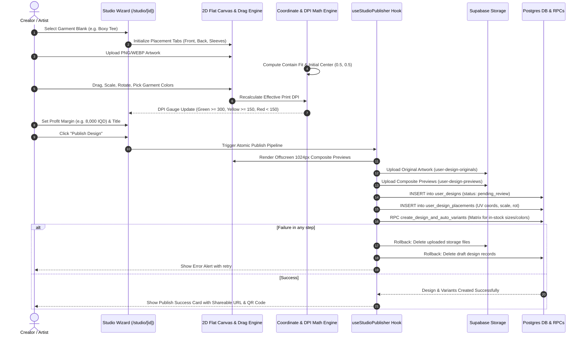
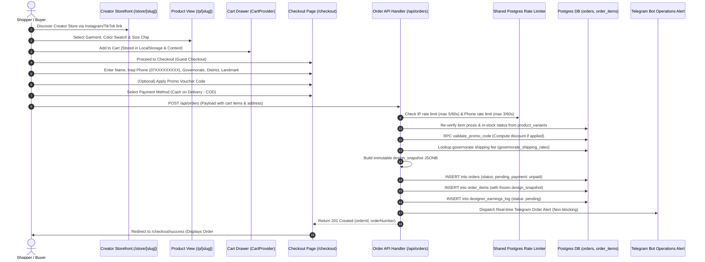
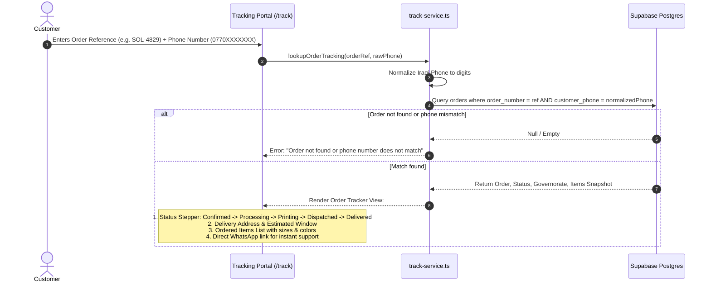
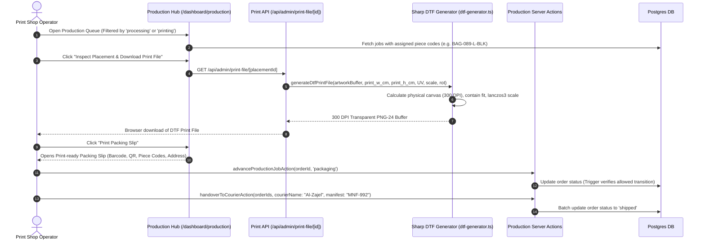
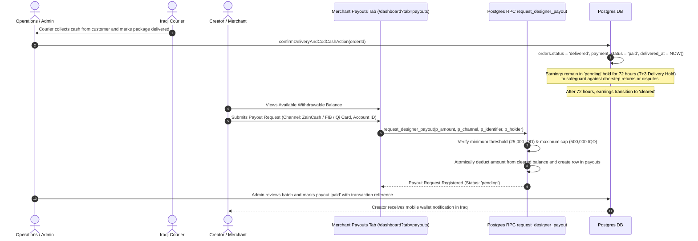
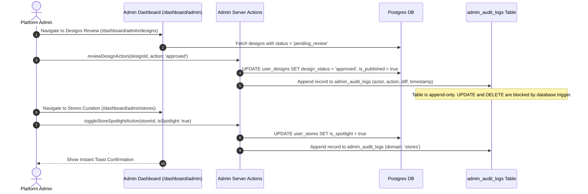

# Solen — End-to-End User & System Flows

This document details the primary lifecycle flows in Solen using visual Mermaid diagrams, mapping customer touchpoints, server actions, background workers, and database state changes.

---

## 1. Creator Journey: Onboarding, Studio Design & Storefront Publishing

---

## 2. Shopper Experience: Discovery, Cart & Iraqi COD Checkout

---

## 3. Customer Order Tracking (Self-Serve Portal)

---

## 4. Fulfillment & Print Hub Production Workflow

---

## 5. Creator Earnings Clearance & Payout Lifecycle (T+3)

---

## 6. Admin Governance & Platform Curation Flow

