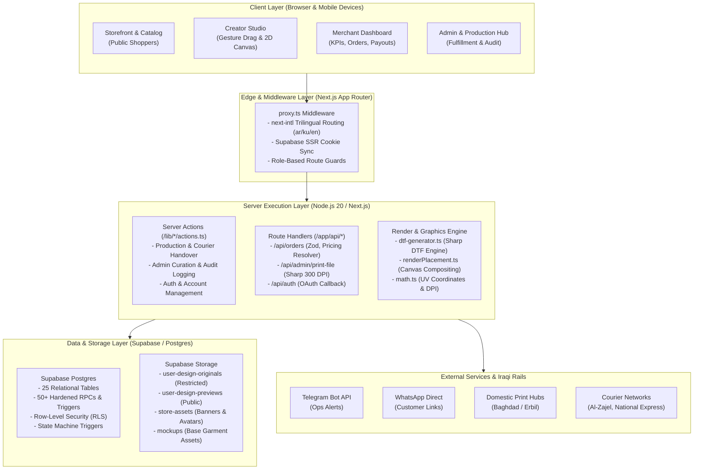

# Solen — System Architecture & Technical Specifications

> **Architecture Philosophy**: A robust, zero-dependency full-stack Next.js monorepo backed by Supabase Postgres, designed for strict financial accuracy, sub-second client performance, and resilient operation across emerging market constraints.

---

## 1. System Topology & Architecture Diagram



---

## 2. The Graphics & Rendering Subsystem

A central innovation in Solen is the decoupled **dual-render pipeline**. Rather than loading heavy 3D rendering engines (WebGL/Three.js) on low-spec Iraqi mobile devices, Solen pairs a lightweight, zero-dependency client 2D compositing engine with an industrial-grade server-side image processing pipeline.

```
┌────────────────────────────────────────────────────────────────────────┐
│                        SHARED PARAMETERS                               │
│  Mockup Dimensions (px) | Printable Area (X, Y, W, H)                  │
│  Physical Size (cm)     | Normalized UV Center (u, v)                  │
│  Scale (contain mult)   | Rotation (degrees)                           │
└───────────────────┬────────────────────────────────┬───────────────────┘
                    │                                │
                    ▼                                ▼
       [Client-Side 2D Compositing]     [Server-Side Sharp DTF Generator]
       File: renderPlacement.ts          File: dtf-generator.ts
       Context: Browser / Canvas2D       Context: Node.js / Sharp
       Purpose: Shopper / Creator UI     Purpose: Industrial Direct-to-Film
       Features:                         Features:
       • Dynamic Garment Tinting         • Exact 300 DPI Pixel Dimensions
       • Multiply Fabric Texture Blend   • 100% Transparent Background
       • Shadow/Wrinkle Overlay          • Lanczos3 Image Resampling
       • Lightweight (< 15 KB JS)        • Zero Garment Texture / Color
```

### Mathematical Coordinate Standard
All artwork placements adhere to normalized UV center coordinates relative to the garment's calibrated printable rectangle:

1. **Normalized Position `(u, v)`**:
   - `u ∈ [0.0, 1.0]`, where `0.5` is the horizontal center of the printable area.
   - `v ∈ [0.0, 1.0]`, where `0.5` is the vertical center of the printable area.
   - Pixel translation formula:
     $$\text{pixelX} = \text{areaX} + u \times \text{areaWidth}$$
     $$\text{pixelY} = \text{areaY} + v \times \text{areaHeight}$$

2. **Contain-Fit Aspect Preserving Scaling**:
   - Prevents graphic stretching. Fits the artwork inside the container while preserving aspect ratio:
     $$\text{scale} = \min\left(\frac{\text{containerWidth}}{\text{artworkWidth}}, \frac{\text{containerHeight}}{\text{artworkHeight}}\right)$$
   - Total rendered dimension:
     $$\text{renderedWidth} = \text{artworkWidth} \times \text{scale} \times \text{userScale}$$
     $$\text{renderedHeight} = \text{artworkHeight} \times \text{scale} \times \text{userScale}$$

3. **Physical 300 DPI Print Calculation**:
   - Given physical centimeters $W_{\text{cm}}$ and $H_{\text{cm}}$:
     $$\text{canvasWidthPx} = \text{round}\left(\frac{W_{\text{cm}}}{2.54} \times 300\right)$$
     $$\text{canvasHeightPx} = \text{round}\left(\frac{H_{\text{cm}}}{2.54} \times 300\right)$$

4. **Dynamic DPI Quality Gauge**:
   - Evaluates the effective output resolution in real-time as the creator scales the artwork:
     $$\text{effectiveDpi} = \frac{\text{sourcePixelWidth}}{\left(\frac{W_{\text{cm}}}{2.54}\right) \times \text{userScale}}$$
   - Thresholds: $\ge 300\text{ DPI}$ (High Quality, Green), $150–299\text{ DPI}$ (Acceptable, Amber), $< 150\text{ DPI}$ (Low Quality Warning, Red).

---

## 3. Server Architecture & Request Flow

### Middleware (`proxy.ts`)
Next.js App Router uses `proxy.ts` as the primary request gatekeeper:
1. **Locale Resolution**: Inspects URL path prefix `/(ar|en|ku)`. If missing, negotiates default locale (`ar`) and issues redirect.
2. **Supabase SSR Cookie Refresh**: Synchronizes authentication JWT cookies using `@supabase/ssr`. Proactively clears corrupted auth cookies to eliminate infinite redirect loops.
3. **Role Guards**: Evaluates user profile role (`customer`, `designer`, `printer`, `admin`) against route trees. Unauthenticated requests to `/dashboard` or `/studio` are redirected to `/login` with sanitized `returnUrl`.

### Server-Authoritative Pricing Resolver (`lib/orders/pricing.ts`)
Client prices submitted in checkout requests are strictly treated as untrusted metadata. The server executes a hardened resolution pipeline:
1. Queries database table `product_variants` by ID in a single query.
2. Verifies variant active status and design approved status (`is_published = true AND design_status = 'approved'`).
3. Fetches authorized integer unit price and creator markup.
4. Assembles an immutable `design_snapshot` JSONB capturing variant title, size, color, hex code, placement coordinates, and artwork URLs frozen at the exact second of purchase.

---

## 4. Internationalization (i18n) & Typography

Solen is built from the ground up for the linguistic realities of Iraq:
- **Locales**: Arabic (`ar`, default, RTL), Kurdish Sorani (`ku`, RTL), English (`en`, LTR).
- **Key Parity**: 2,542 unique localization keys across all three languages validated via automated script `scripts/test-i18n-parity.mjs`.
- **Typography**:
  - Arabic & Kurdish: **IBM Plex Sans Arabic** for exceptional legibility and optical weight balance.
  - English: **Playfair Display** (editorial headings) paired with **IBM Plex Sans** (body).
- **Western Arabic Numerals Invariant**: Iraqi commerce universally utilizes Western Arabic digits (`1, 2, 3, 4, 5, 6, 7, 8, 9, 0`). The application enforces this standard across all locales, avoiding eastern numerals (`١, ٢, ٣`) to prevent payment and tracking ambiguities.

---

## 5. Security Architecture & Threat Mitigation

| Security Layer | Implementation | Threat Addressed |
|---|---|---|
| **Postgres RLS** | Row-Level Security enabled on all 25 tables. Policies utilize `(select auth.uid())` subqueries. | Horizontal privilege escalation; tenant data leakage. |
| **Search Path Hardening** | `SET search_path = public, pg_temp` defined on all database functions. | Malicious schema injection attacks. |
| **Least-Privilege RPC** | Administrative functions have `EXECUTE` privileges revoked from `anon` and `public`. | Unauthorized execution of sensitive state transitions. |
| **Shared Rate Limiting** | Dual-tier rate limiting backed by Postgres `rate_limits` table with in-memory token bucket fallback. | Checkout spam, phone harassment, and brute force attacks. |
| **File Binary Validation** | Magic-byte signature checking for PNG (`89 50 4E 47`), JPEG (`FF D8 FF`), and WEBP (`52 49 46 46`). | Polyglot script uploads masquerading as images. |
| **Open Redirect Shield** | Destination URLs sanitized via `getSafeRedirectUrl()`, restricting redirects to relative platform paths. | Phishing and credential theft via malicious redirect queries. |
| **Immutable Audit Logs** | Append-only `admin_audit_logs` table protected by a trigger blocking `UPDATE` and `DELETE`. | Tampering with administrative audit trails. |

---

## 6. Continuous Integration & Quality Engineering

The Solen repository is guarded by a 4-stage GitHub Actions CI workflow ([`.github/workflows/ci.yml`](file:///d:/flutter_projects/solen_web/.github/workflows/ci.yml)):

```
┌────────────────────────────────────────────────────────────────────────┐
│                        CONTINUOUS INTEGRATION                          │
├──────────────────────┬──────────────────────┬──────────────────────────┤
│ Stage 1: Static      │ Stage 2: Database    │ Stage 3: Build &         │
│ Analysis & Quality   │ Schema Verification  │ Secret Audit             │
├──────────────────────┼──────────────────────┼──────────────────────────┤
│ • ESLint (0 errors)  │ • Ephemeral Supabase │ • Next.js Production     │
│ • TypeScript Strict  │   CLI Start          │   Build                  │
│ • 400-Line File Rule │ • Apply Migrations   │ • Client Bundle Scan     │
│ • Knip Dead Code     │ • db lint Security   │   (Zero leaked secrets)  │
│ • Trilingual Parity  │ • Type Sync Verify   │                          │
│ • 56 Vitest Files    │                      │ Stage 4: Playwright E2E  │
│   (445 unit tests)   │                      │ • Chromium Specs         │
└──────────────────────┴──────────────────────┴──────────────────────────┘
```
