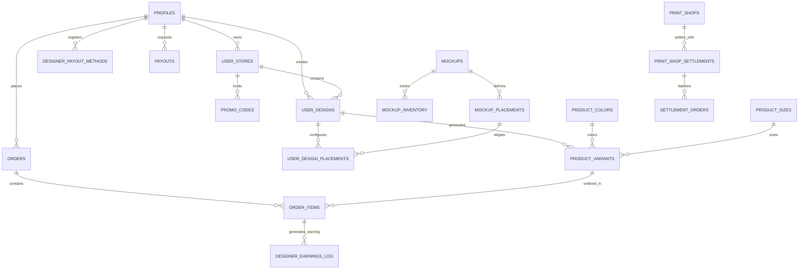

# Solen — Database Schema & Data Architecture

> **Database Engine**: PostgreSQL 15+ managed via Supabase. Managed exclusively through 36 sequential migration files in `/supabase/migrations/`.

---

## 1. Architectural Principles & Conventions

1. **Zero-Float Currency Standard**: All monetary values in Iraqi Dinars (`IQD`) are strictly stored as integer types (`integer` or `bigint`). Floating-point types (`float`, `real`, `numeric` without scale) are prohibited for currency to eliminate rounding discrepancies.
2. **Normalized Placement Architecture**: Replaced legacy garment columns with dynamic placement entities (`mockup_placements`, `user_design_placements`), allowing garments to support arbitrary printable zones (front, back, left sleeve, right sleeve, hood, pocket).
3. **Immutable Snapshots**: Order lines freeze complete design coordinates, artwork URLs, and pricing at the exact moment of order placement inside `order_items.design_snapshot` (JSONB), protected by a database trigger that rejects updates.
4. **Append-Only Auditing**: Security and governance events are logged to `admin_audit_logs`, where `UPDATE` and `DELETE` operations are strictly blocked by triggers.
5. **Least-Privilege Security Definer**: All functions specify `SET search_path = public, pg_temp` to prevent search path poisoning, and administrative RPCs have `EXECUTE` revoked from `anon` and `public`.

---

## 2. Entity-Relationship Diagram (Core Domain)



---

## 3. Database Enums Reference

| Enum Name | Values | Purpose |
|---|---|---|
| `public.user_role` | `customer`, `designer`, `printer`, `production_manager`, `admin` | Platform authorization & navigation gatekeeper. |
| `public.store_status` | `pending`, `approved`, `rejected` | Merchant storefront approval lifecycle. |
| `public.design_status` | `draft`, `pending_review`, `approved`, `rejected` | Artwork moderation and catalog publish state. |
| `public.order_status` | `pending`, `processing`, `printing`, `packaging`, `shipped`, `delivered`, `cancelled`, `refunded` | Rigid order fulfillment lifecycle state machine. |
| `public.payment_status` | `unpaid`, `paid`, `partially_refunded`, `fully_refunded`, `failed` | Payment collection state (COD cash / wallet transfer). |
| `public.earning_status` | `pending`, `cleared`, `cancelled` | Creator earnings hold (T+3 post-delivery clearance). |
| `public.payout_status` | `pending`, `processing`, `paid`, `failed`, `cancelled` | Creator withdrawal request lifecycle. |
| `public.payout_method_type` | `zain_cash`, `fib`, `qi_card`, `fastpay`, `cash_pickup` | Supported Iraqi payment rails for creator payouts. |
| `public.iraq_governorate` | `baghdad`, `basra`, `erbil`, `sulaymaniyah`, `duhok`, `najaf`, `karbala`, `kirkuk`, `nineveh`, `babil`, `anbar`, `dhi_qar`, `diyala`, `maysan`, `al_qadisiyyah`, `muthanna`, `wasit`, `saladin` | The 18 official governorates of Iraq. |

---

## 4. Key Relational Tables

### 1. Catalog & Mockup Architecture
- `mockups`: High-level garment templates (e.g., Heavyweight Oversized Tee). Stores name, default base cost, and active status.
- `mockup_placements`: Printable zones per mockup. Stores photographic base image, printable rectangle coordinates (`printable_area_x/y/w/h`), physical print dimensions (`print_width_cm`, `print_height_cm`), and fabric texture overlay.
- `product_colors` & `product_sizes`: Master taxonomy for garment colorways (with hex codes) and apparel sizes (S, M, L, XL, 2XL, 3XL).
- `mockup_inventory`: Matrix of available stock per mockup × color × size.

### 2. Creator Designs & Variants
- `user_designs`: Creator-authored products. Tracks title, description, category, profit markup (`designer_markup`), publication status, and moderation status (`design_status`).
- `user_design_placements`: Configuration per placement zone. Stores normalized center coordinates (`design_position_x/y`), scale multiplier (`design_scale`), rotation (`design_rotation`), and URLs for original artwork and composite preview.
- `product_variants`: The purchasable SKU matrix. Dynamically generated across available color and size combinations. Stores computed retail price in IQD.

### 3. Orders & Iraqi Commerce
- `orders`: Master order ledger. Stores customer contact info, normalized Iraqi phone (`customer_phone`), delivery address (governorate, district, landmark), delivery notes, shipping cost, promo discount, total integer amount (`total_amount`), and fulfillment status.
- `order_items`: Line items. Stores variant ID, ordered quantity, unit price, creator markup, and the frozen `design_snapshot` (JSONB).
- `governorate_shipping_rates`: Regional delivery fees and transit days for all 18 governorates.
- `promo_codes`: Vouchers supporting percentage and flat discounts, expiration dates, usage counters, and merchant vs. platform funding scopes.

### 4. Creator Financials & Settlements
- `designer_earnings_log`: Granular earnings ledger per ordered item. Tracks gross creator markup, promo deductions, and clearance status (`pending` → `cleared`).
- `designer_payout_methods`: Stored Iraqi payout accounts (ZainCash phone, FIB IBAN, Qi Card number).
- `payouts`: Batch withdrawal requests with audit verification and status tracking.
- `print_shops` & `print_shop_settlements`: Settlement ledger for domestic fulfillment partners in Baghdad and Erbil.

### 5. Platform Security & Operations
- `admin_audit_logs`: Append-only governance log capturing administrative actor, domain, action, target ID, and JSON metadata.
- `rate_limits`: Distributed counter table for IP and phone rate limiters.
- `global_config`: Singleton configuration table storing USD-IQD exchange rate, base shipping fee, fixed platform fee, and platform commission percentage.

---

## 5. Critical Database Triggers & Business RPCs

### 1. Immutable Design Snapshot Trigger
Enforces that once an order item is inserted, its design specifications cannot be altered under any circumstance:

```sql
CREATE OR REPLACE FUNCTION public.protect_design_snapshot()
RETURNS trigger AS $$
BEGIN
  IF old.design_snapshot IS DISTINCT FROM new.design_snapshot THEN
    RAISE EXCEPTION 'design_snapshot is immutable once an order_item is created';
  END IF;
  RETURN new;
END;
$$ LANGUAGE plpgsql;

CREATE TRIGGER trg_protect_design_snapshot
  BEFORE UPDATE ON public.order_items
  FOR EACH ROW EXECUTE FUNCTION protect_design_snapshot();
```

### 2. Order Status State Machine Trigger
Prevents invalid status hops and ensures proper fulfillment progression:

```sql
CREATE OR REPLACE FUNCTION public.enforce_order_status_transition()
RETURNS trigger AS $$
BEGIN
  IF (OLD.status = 'pending'    AND NEW.status IN ('processing', 'printing', 'cancelled')) OR
     (OLD.status = 'processing' AND NEW.status IN ('printing', 'shipped', 'cancelled')) OR
     (OLD.status = 'printing'   AND NEW.status IN ('packaging', 'shipped', 'cancelled')) OR
     (OLD.status = 'packaging'  AND NEW.status IN ('shipped', 'cancelled')) OR
     (OLD.status = 'shipped'    AND NEW.status IN ('delivered', 'cancelled', 'refunded')) OR
     (OLD.status = 'delivered'  AND NEW.status = 'refunded') THEN
    RETURN NEW;
  END IF;
  RAISE EXCEPTION 'Invalid order status transition: % -> %', OLD.status, NEW.status;
END;
$$ LANGUAGE plpgsql;
```

### 3. Atomic Creator Payout Request RPC
Validates financial invariants before debiting balances:
- Verifies that available balance meets the minimum threshold (**25,000 IQD**).
- Applies daily maximum cap (**500,000 IQD**).
- Restricts eligible earnings strictly to orders delivered for at least 72 hours (T+3 delivery hold).
- Atomically creates payout record and updates earnings log status.

### 4. Append-Only Audit Log Trigger
Guarantees administrative audit trails cannot be erased or modified:

```sql
CREATE OR REPLACE FUNCTION public.protect_admin_audit_logs()
RETURNS trigger AS $$
BEGIN
  RAISE EXCEPTION 'admin_audit_logs is an append-only table. UPDATE and DELETE are prohibited.';
END;
$$ LANGUAGE plpgsql;

CREATE TRIGGER trg_protect_admin_audit_logs
  BEFORE UPDATE OR DELETE ON public.admin_audit_logs
  FOR EACH ROW EXECUTE FUNCTION protect_admin_audit_logs();
```
